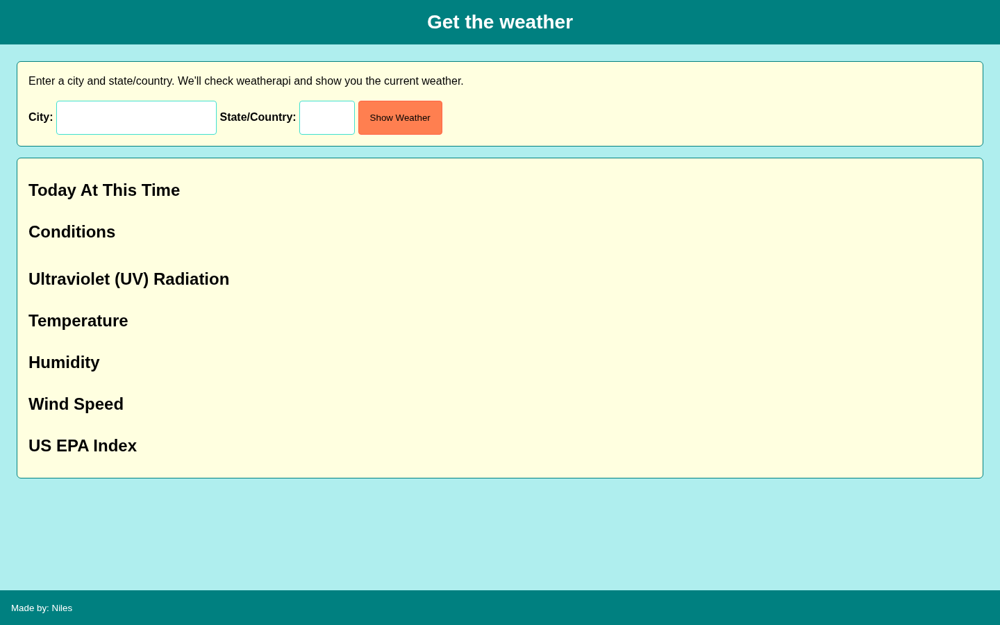

# Current Weather Lookup

Look up current weather and air-quality information for a city using WeatherAPI.

## Overview

Current Weather Lookup lets a user enter a city and a two-character state or country value, then requests current conditions from WeatherAPI.

The application displays the returned weather condition, weather icon, UV level, temperature, feels-like temperature, humidity, wind speed, and U.S. EPA air-quality index.

## Features

- Search by city and state or country
- Retrieve current weather data from WeatherAPI
- Display weather condition and icon
- Display UV level
- Display current and feels-like temperatures
- Display humidity
- Display wind speed
- Display U.S. EPA air-quality information
- Display the date and time of the request

## Technologies

<p>
  <a href="https://developer.mozilla.org/en-US/docs/Web/HTML" title="HTML">
    
  </a>
  &nbsp;
  <a href="https://developer.mozilla.org/en-US/docs/Web/CSS" title="CSS">
    
  </a>
  &nbsp;
  <a href="https://developer.mozilla.org/en-US/docs/Web/JavaScript" title="JavaScript">
    
  </a>
</p>

- [WeatherAPI](https://www.weatherapi.com/)

## How to Run

1. Clone the repository:

```bash
git clone https://github.com/nilesleesmith/simple-weather-app.git
```

2. Open `js/main2.js`.

3. Replace the placeholder `yourKeyAPI` value with a valid WeatherAPI key.

4. Open `index.html` in a web browser.

No additional packages or build steps are required.

## Live Site

https://nilesleesmith.github.io/simple-weather-app/

## Screenshots


